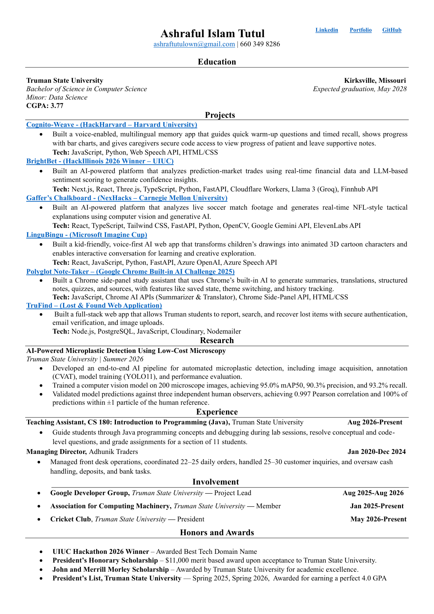

# Ashraful Islam Tutul — Portfolio

A responsive personal portfolio built from Ashraful's latest résumé. It highlights selected AI projects, research, experience, education, awards, and community involvement.

## Run locally

```bash
pip install -r requirements.txt
python main.py
```

Open `http://localhost:8000` in a browser.

## Routes

- `/` — portfolio
- `/resume` — downloadable résumé
- `/health` — health check

## Résumé

[Download the PDF](uploads/Resume.pdf)


